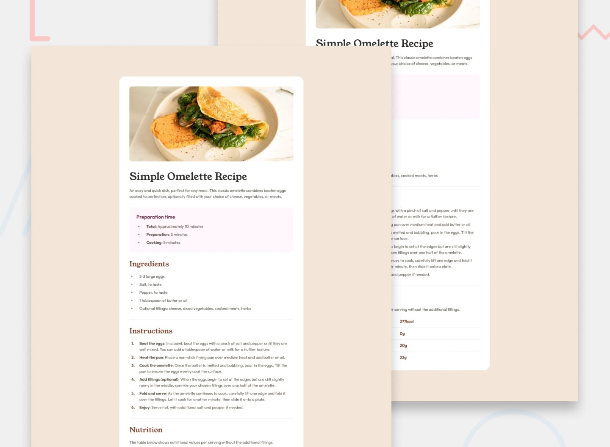

# Simple Omelette Recipe

This is a solution to the [Recipe page challenge on Frontend Mentor](https://www.frontendmentor.io/challenges/recipe-page-KiTsR8QQKm). Frontend Mentor challenges help you improve your coding skills by building realistic projects.

## Table of contents

- [Overview](#overview)
  - [Screenshot](#screenshot)
  - [Links](#links)
- [My process](#my-process)
  - [Built with](#built-with)
  - [What I learned](#what-i-learned)
  - [Continued development](#continued-development)
  - [Useful resources](#useful-resources)
  - [AI Collaboration](#ai-collaboration)
- [Author](#author)
- [Acknowledgments](#acknowledgments)

---

## Overview

### Screenshot



> **Tip:** To add your own screenshot, open the page in a browser, take a screenshot, crop/optimize it, save it as `screenshot.jpg`, and update the path above.

### Links

- Solution URL: [Add your repo link here](https://github.com/yourusername/recipe-page)
- Live Site URL: [Add your live site URL here](https://your-username.github.io/recipe-page/)

---

## My process

### Built with

- Semantic HTML5 markup (`header`, `main`, `section`, `nav`, etc.)
- CSS (embedded in `index.html` — feel free to move to a separate `.css` file as you grow!)
- Flexbox for layout
- Responsive design (mobile-first approach: start at 375 px, scale to 1440 px)
- Google / local fonts (`Outfit`, `YoungSerif`)

> **Note:** This is a beginner-level project. You don't need React or advanced frameworks — just clean HTML and CSS is perfect for learning the fundamentals.

### What I learned

Use this section to recap what felt new or challenging. For example:

- How to use `font-face` for local fonts
- Matching colors exactly with `hsl()` values from a style guide
- Making images responsive with `object-fit` and `width: 100%`
- Using flexbox for vertical stacking vs. row layouts

```css
/* Example of a style you might be proud of */
.card-image {
  width: 100%;
  height: 200px;
  object-fit: cover;
  display: block;
}
```

### Continued development

- Move all inline `<style>` code into a separate `styles.css` file for cleaner organization
- Practice using CSS custom properties (`:root`) to manage colors from the style guide
- Add a tablet layout (between 375 px and 1440 px) for smoother scaling
- Improve accessibility: add meaningful `alt` text to images and ensure focus states on links

### Useful resources

- [MDN Web Docs – CSS Flexbox](https://developer.mozilla.org/en-US/docs/Web/CSS/CSS_Flexible_Box_Layout) — great for beginners
- [CSS-Tricks Flexbox Guide](https://css-tricks.com/snippets/css/a-guide-to-flexbox/) — visual explanations
- [Frontend Mentor Style Guide](https://www.frontendmentor.io/challenges/recipe-page-KiTsR8QQKm) — reference for colors, fonts, and layouts
- [The Markdown Guide](https://www.markdown-guide.org/) — if you need help writing README files

### AI Collaboration

> Thinking about using AI? Read `AGENTS.md` first! It explains how AI assistants can guide you without doing the work for you.

- **Tools used:** (e.g., ChatGPT, Claude, GitHub Copilot, or none yet)
- **How used:** (e.g., asking for explanations, debugging styling, reviewing HTML structure)
- **What worked:** (e.g., getting analogies for flexbox, clarifying color formats)
- **What didn't:** (e.g., copying full code blocks instead of learning step-by-step)

> Remember: struggling with a problem is where real learning happens. Use AI for hints and explanations, then try writing the code yourself.

---

## Author

- Your name — [@yourusername](https://github.com/edris-mazhari)
- Frontend Mentor — [@yourusername](https://www.frontendmentor.io/profile/yourusername)

---

## Acknowledgments

- Thanks to [Frontend Mentor](https://www.frontendmentor.io) for the challenge design and assets
- Thank you to anyone who gave feedback, encouraged you, or shared a tip!
- If this project represents your first or early front-end project, give yourself credit — starting is the hardest part.

---

**Have fun building!** 🚀  
Remember: every developer looks things up constantly. You're not supposed to know everything right away. Keep experimenting, ask questions, and enjoy the process.
